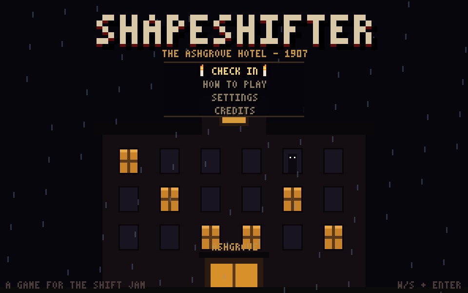
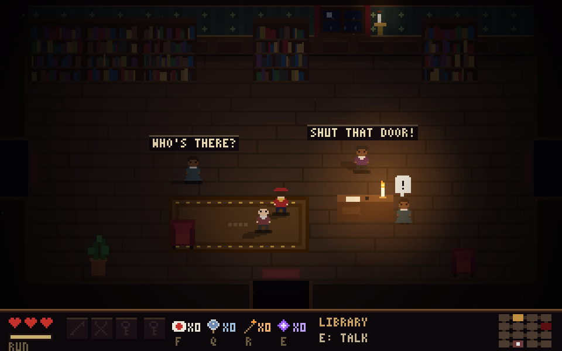
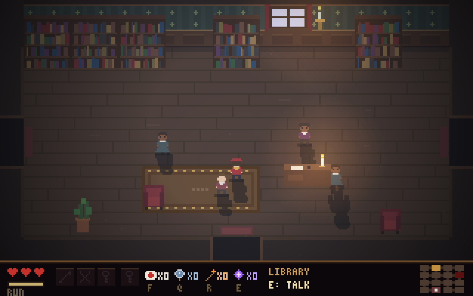
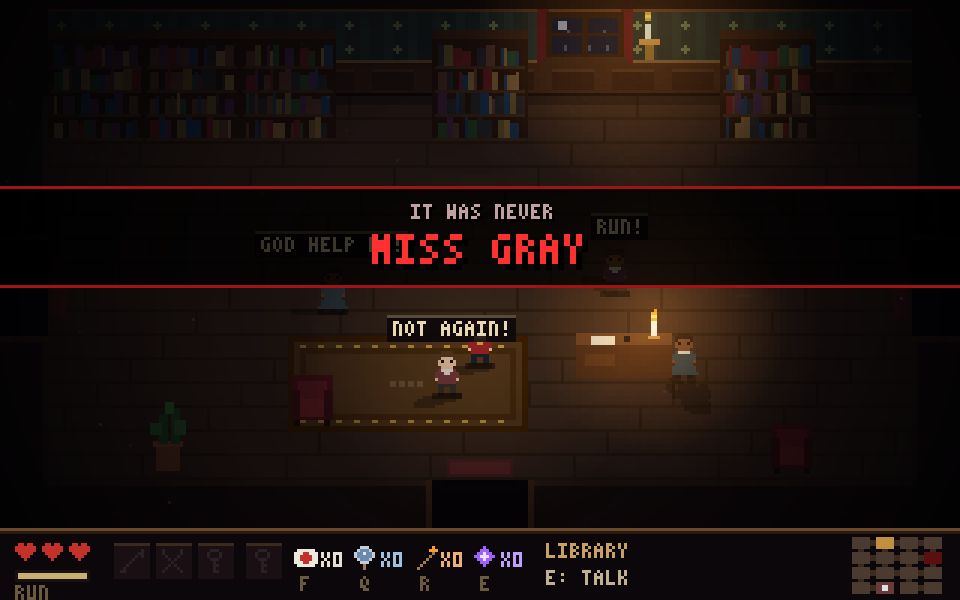
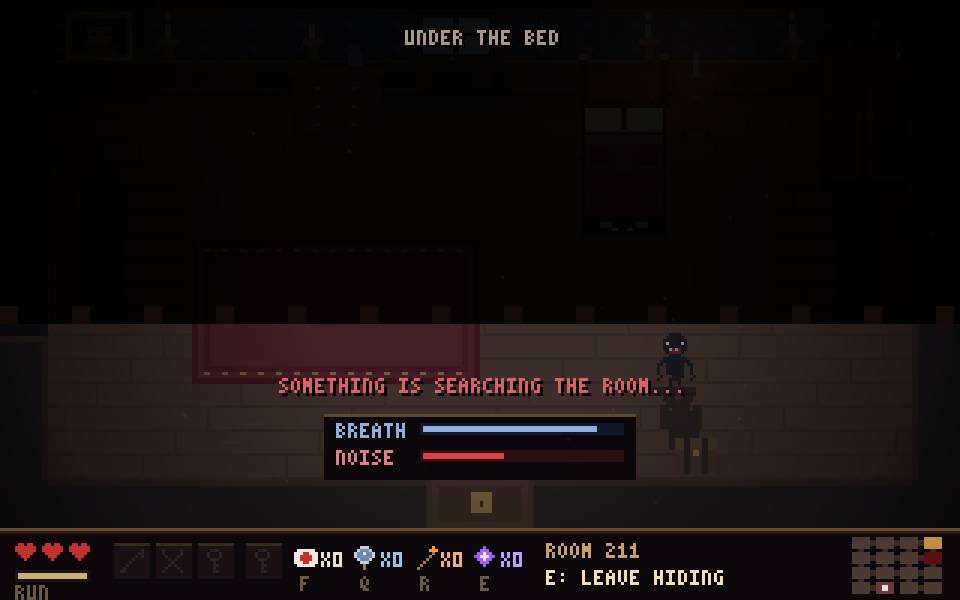
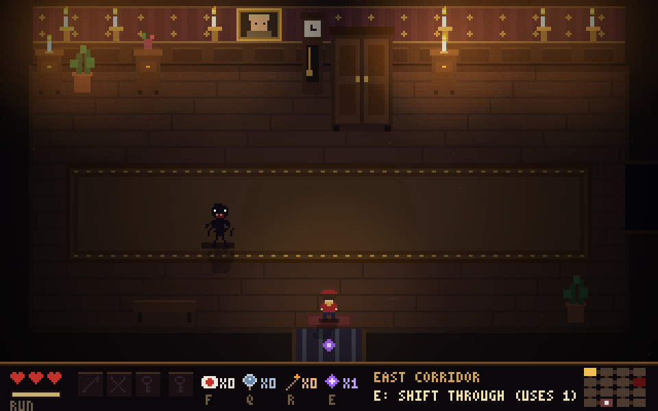

# SHAPESHIFTER — The Ashgrove Hotel, 1907

*One of these guests isn't a guest.*

A pixel-art horror game made by **Wesley Bird** for **GitHub Game Off 2026** (theme: **SHIFT**).

▶ **Play in your browser:** https://fellowrasberrian.github.io/SHIFT/

## About

November 14, 1907. A storm has trapped you, the night bellhop, inside the Ashgrove Hotel. Something checked in with you, and it disguises itself as the other guests.

Search the rooms for a crowbar, bolt cutters and the lobby key, then escape through the front doors. Don't get caught: it won't kill you right away. It takes a little more of you each time it catches you.

## How to spot it

- It has no shadow.
- It reacts a beat later than everyone else.
- It repeats what other guests say.
- Real guests never walk between rooms.
- When the lightning flashes, its shadow is its true shape.
- Mirrors show what it really is.

## Controls

| Key | Action |
| --- | --- |
| WASD / Arrow keys | Move |
| Shift | Run |
| E | Search, talk, hide, use doors |
| Space | Hold your breath while hiding |
| Q | Pocket mirror |
| R | Strike a match |
| F | Use a bandage |
| Esc | Pause and read the journal |
| M | Mute |

## How "SHIFT" fits the game

- The monster is a **shapeshifter** hiding among the guests.
- You **shift** room to room through the hotel, which is randomly built every run.
- **Shifts** found in drawers let you pass through sealed doors that it can't follow you through.
- You hold **Shift** to run for your life.

## Features

- A new hotel layout every run, with 16 rooms including a ballroom, library, washroom and a sealed suite
- Hide in wardrobes, under beds or in bathtubs, and hold your breath while it searches
- Three struggle minigames when it catches you
- Six journal pages that tell the hotel's story
- Three endings, including a hidden true ending
- Procedural music-box soundtrack, thunderstorm and sound effects made with the Web Audio API

## Tech

The whole game is a single `index.html` file: plain JavaScript and the HTML5 Canvas, with no engine and no external dependencies. All the art is drawn in code, and all the sound is generated live with the Web Audio API. To run it locally, download `index.html` and open it in a browser.

## Credits

Created by **Wesley Bird**.
Made for GitHub Game Off 2026.
